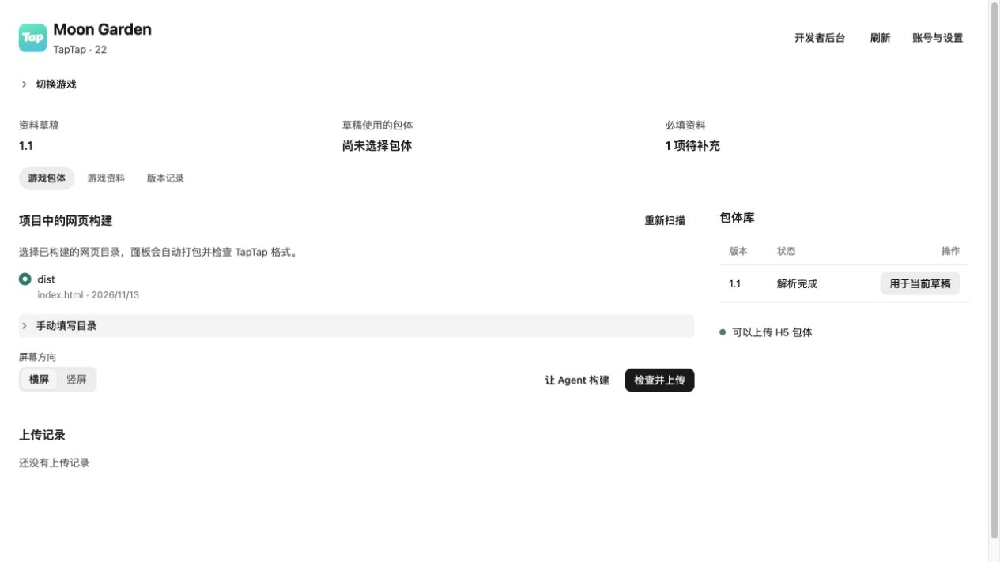
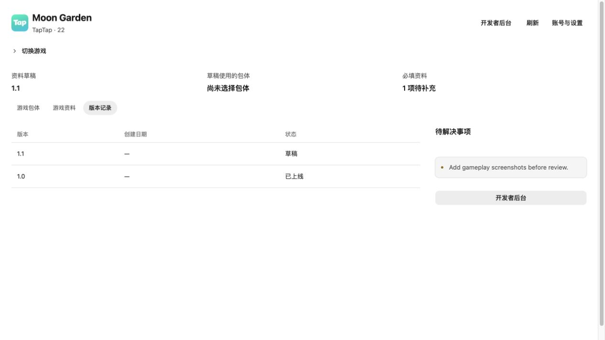

# TapTap H5 publishing

TapTap (`@ohmygame/taptap`, Beta) publishes existing H5 web
builds with the official `taptap-cli`. Enable it for a web game, general project
with a web build, or Godot web export, then choose **Publish → Manage on
TapTap…**. It leaves the engine, project type and preview unchanged. The
separate TapTap Maker plugin keeps its development and Spark release workflow.



The panel reads the CLI's existing login state, lists developers and searchable,
paged games, and remembers the selected H5 app per local workspace. A declared H5
game with conflicting capabilities can be inspected, but cannot upload or bind;
the panel shows the platform diagnosis instead of changing its package type.
Install the CLI using its [official instructions](https://developer.taptap.cn/v3/cli/).
The **CLI settings** path can select an executable when it is not on PATH;
Windows requires the actual CLI `.exe`, not the npm `.cmd` shim. Login and
installation can be handed to the agent from the panel. Credentials stay in
the CLI's own store. The panel currently requires CLI contract 3; it was checked
against `2026.11.12` and metadata `1.0.77`.

- **Builds:** discovers project directories containing `index.html`, prioritizing
  common build/export folders. Select a completed build and orientation, then
  **Check and upload** packages it under `.ohmygame/local/taptap/`, runs the CLI
  preflight and asks to confirm the exact target, size and warnings. It checks
  the ZIP's SHA-256 before upload. Keep generated ZIPs until tasks are resolved.
  Discovery skips hidden/dependency folders and symlinks, and is bounded to 4,000
  entries and five directory levels; a manual project folder remains available.
- **Package library:** shows current H5 candidates and the draft's main binding.
  **Use in draft** verifies an editable draft, a ready candidate and the exact
  current slot snapshot, then previews, binds and reads it back. Uploading and
  binding are separate actions; neither submits review. If no editable draft
  exists, use the developer console to create one first.
- **Store page:** edit basic text, category, developer words and supported image
  fields directly, with a store-content preview. Choose PNG/JPEG/WebP images
  from the project grid or choose/drop a local image in the image dialog.
  Local images up to 20 MB are imported into `taptap-materials/` through the
  existing project-file bridge after upload confirmation; an imported copy is
  retained for retries. Selection alone performs no write or upload. Upload
  stores the image in the material library, and **Save draft** applies their complete metadata to the chosen field. Screenshot arrays
  can append or remove images. Current image specifications appear beside each
  field; unsupported/video/distribution settings remain in the developer console.
  Click an existing thumbnail to enlarge it; Escape or the close button returns
  focus to the thumbnail. Prepared packages show their local archive path.
  Image preview only fetches read-back URLs on `img.tapimg.com` and `img-tc.tapimg.com`, with no credentials,
  no redirects and a 5 MB limit. Other image hosts show an unavailable preview.
- **Draft edits:** local edits persist per developer/game and section through
  refreshes, tab changes and panel reopening. Save uses each original field
  snapshot, refuses remote drift, verifies fields independently and preserves
  unresolved edits after a partial save. Discard affects local edits only.
- **Versions:** paged history, draft state, reported blockers and warnings.
  Review/release remain explicit agent workflows from the plugin commands and
  developer console; the panel has no submit-review or publish button.

The native host owns an upload independently of the panel's visibility; hiding
it does not cancel the CLI. The versioned panel state in the plugin data folder
retains upload intents, stable CLI receipt handles, image upload receipts and the
latest draft mutation intent, without credentials or full CLI responses. On restart an interrupted upload becomes **unknown**;
check its artifact/task before retrying. Unknown outcomes without a receipt need
CLI task-history reconciliation by the agent; they block starting another upload.
Read failures are shown separately, never rendered as an empty successful list.
Agent/console changes are visible after **Refresh**.

The standalone Node helper at
`skills/taptap-h5-publish/scripts/package-h5.mjs` streams a ZIP32
archive with exactly `game/index.html` and its sibling assets. It does not build
or upload; it refuses missing entries, symlinks, source/credential metadata,
outputs inside the build, paths outside the workspace, existing output files and
ZIP64-sized inputs. It skips macOS metadata and reports other hidden entries.
The CLI preflight remains authoritative for TapTap's current package contract.

See the [H5 publishing Skill](skills/taptap-h5-publish/SKILL.md)
and [manual acceptance](docs/acceptance.zh-CN.md).
Local archive/preflight tests and fixture-driven panel checks do not verify
live uploads, platform gameplay, review acceptance or publication; those require
a developer account and an explicitly selected test app.



## Development and release

Use an OhMyGame checkout containing the companion plugin-ui changes (API 2.7).
Add this folder through **Plugins → Add plugin → This computer**, with Develop
on, and allow its requested capabilities. It does not replace TapTap Maker.
The new package is not in the host's preinstall lock yet.

Merge the host component PR before releasing this package. Publication happens
through this repository's normal main-branch workflow; only after npm has the
published bytes should the host add an exact version and integrity to
`config/preinstalled-plugins.json`. Do not pin an unpublished package.

`npm test` includes the migrated service and panel tests. Set `OHMYGAME_APP` to
a compatible host checkout (defaults to `app/`). For browser regressions, run
from that checkout, replacing `<plugins-repo>` with this repository's path:

```sh
bun run plugin-ui:regression --scenarios <plugins-repo>/test/taptap/panel-scenarios.json <plugins-repo>/plugins/taptap
```
